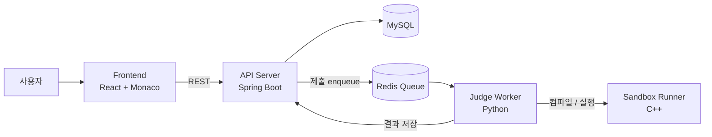

# CodeArena

> 코드를 제출하면 격리된 환경에서 실행하고 채점하는 **온라인 저지(Online Judge) 플랫폼**


## 왜 만들었나

백준, 프로그래머스 같은 채점 사이트를 쓰면서 이런 게 궁금했습니다.

- 남이 올린 코드를 서버에서 실행해도 **안전한가?**
- 수천 명이 동시에 제출하면 **채점 대기열은 어떻게 처리되는가?**
- 시간·메모리 사용량은 **어떻게 정확히 측정하는가?**

이 질문들에 직접 답해 보려고 채점 엔진부터 웹 서비스까지 전부 구현하는 프로젝트입니다.

## 아키텍처



| 모듈 | 언어 | 역할 |
|---|---|---|
| `frontend/` | React, TypeScript | 문제 보기, 코드 에디터, 채점 결과 표시 |
| `api/` | Java 21, Spring Boot | 회원·문제·제출 관리, 채점 요청 발행 |
| `judge-worker/` | Python | 큐에서 제출을 꺼내 컴파일 → 테스트케이스별 실행 → 결과 비교 |
| `sandbox/` | C++17 | 제출 프로그램을 시간·메모리 제한 하에 실행하고 사용량 측정 |

## 진행 상황

- [x] **1단계** 레포 구조, 개발 환경(docker-compose), API 서버 뼈대
- [x] **1단계** Sandbox Runner v0.1: rlimit 기반 시간·메모리 제한, OK/TLE/MLE/RE 판정
- [x] **2단계** Judge Worker: Redis 큐 소비, C++/Python/Java 컴파일 및 채점, 테스트 26개 ([설계 기록](docs/02-judge-worker.md))
- [ ] **3단계** API: 회원(JWT), 문제, 제출 도메인
- [ ] **4단계** Frontend: 문제 목록, 에디터, 실시간 결과
- [ ] **5단계** 격리 강화: Docker 컨테이너 실행, seccomp, cgroup
- [ ] **6단계** 배포 및 부하 테스트

자세한 일정은 [docs/ROADMAP.md](docs/ROADMAP.md)를 참고하세요.

## 실행 방법

```bash
# 1. 환경 변수
cp .env.example .env

# 2. MySQL, Redis 실행
docker compose up -d

# 3. API 서버 (IntelliJ에서 api/ 폴더를 Gradle 프로젝트로 열어 실행해도 됨)
cd api && ./gradlew bootRun
curl localhost:8080/api/ping

# 4. Judge Worker 테스트 및 실행 (Docker)
docker build -f judge-worker/Dockerfile --target test -t codearena-judge-test .
docker run --rm codearena-judge-test
docker compose up -d --build redis judge-worker

# 5. 제출해 보기
docker compose exec -T judge-worker python -m judge_worker.submit --problem 1000 --lang python < judge-worker/tests/solutions/ac.py
```

## 기술적 고민 기록

구현하면서 부딪힌 문제와 해결 과정은 [docs/](docs/)에 정리합니다.
