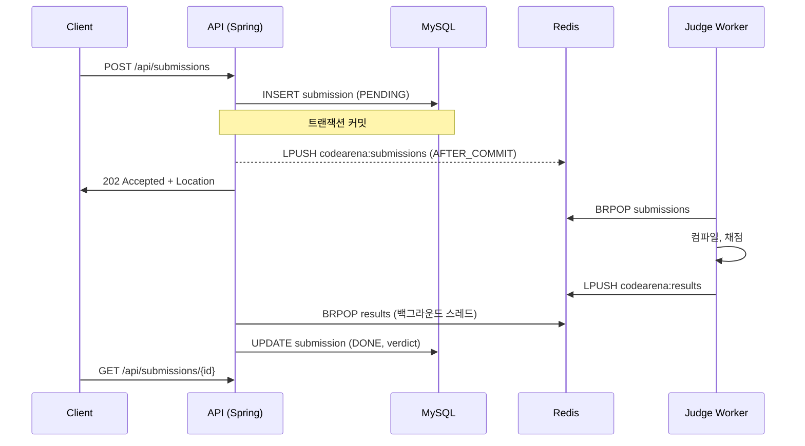

# 3단계-2: 제출 API와 채점 흐름 연결

## 전체 흐름



## 1. 큐 전송은 반드시 커밋 "이후"에

처음 떠올리기 쉬운 코드는 이렇다.

```java
@Transactional
public void submit(...) {
    submissionRepository.save(submission);
    redis.leftPush(...);   // 트랜잭션 안에서 바로 전송
}
```

이러면 두 가지 문제가 생긴다.

1. **워커가 너무 빠를 때:** 커밋 전에 워커가 채점을 끝내고 결과를 보내면, API는 아직 커밋되지 않은 제출을 DB에서 찾지 못한다.
2. **롤백될 때:** 큐 전송 뒤에 예외가 나서 롤백되면, DB에는 없는 제출이 채점된다.

그래서 서비스는 `SubmissionCreatedEvent`만 발행하고, `@TransactionalEventListener(phase = AFTER_COMMIT)`가 커밋이 확정된 뒤에 큐로 보낸다.

## 2. 결과 반영은 멱등하게

워커 재시도나 메시지 중복으로 같은 결과가 두 번 올 수 있다. `Submission.applyResult()`는 이미 `DONE`인 제출을 무시해서,
같은 메시지를 여러 번 처리해도 결과가 같다(멱등성). API 서버를 여러 대 띄워 결과 큐를 나눠 소비해도 안전하다.

## 3. 비동기 API는 202 Accepted

채점은 몇 초가 걸릴 수 있어서 요청 안에서 기다리지 않는다. `202 Accepted`와 함께 `Location: /api/submissions/{id}`를 돌려주고,
클라이언트는 그 URL로 결과를 조회한다. 4단계 프론트에서 폴링 또는 SSE로 바꿀 예정이다.

## 4. 결과 큐 소비 스레드

- `SmartLifecycle`로 구현해 애플리케이션 시작/종료와 생명주기를 맞췄다. 종료 시 루프를 멈추고 스레드를 정리한다.
- `BRPOP`은 블로킹 명령이라, Spring Data Redis(Lettuce)는 공유 커넥션이 아니라 전용 커넥션에서 실행한다.
- Redis가 잠시 죽어도 스레드가 죽지 않도록 예외 시 3초 쉬고 재시도한다.
- JSON이 깨진 메시지는 버리고 다음 메시지를 계속 처리한다. 한 건 때문에 전체가 멈추지 않게 하기 위해서다.

## 5. Python 워커와의 메시지 계약

Java는 camelCase, Python은 snake_case를 쓴다. 메시지 record에 `@JsonProperty("submission_id")`처럼 명시하고,
`SubmissionQueuePublisherTest`와 `JudgeResultConsumerTest`에서 **워커가 실제로 주고받는 JSON 형식 그대로** 검증한다.
Spring Boot 4는 Jackson 3를 쓰기 때문에 `JsonMapper`는 `tools.jackson.databind.json`에서 가져오고, 어노테이션은 그대로 `com.fasterxml.jackson.annotation`을 쓴다.

## 6. MySQL과 Hibernate enum 매핑

Hibernate 6 이상은 MySQL에서 `@Enumerated(STRING)`을 네이티브 `ENUM` 타입으로 매핑하려 한다.
Flyway로 만든 `VARCHAR` 컬럼과 스키마 검증이 충돌하므로 `@JdbcTypeCode(SqlTypes.VARCHAR)`로 명시했다.
enum 값을 추가할 때 `ALTER TABLE`이 필요 없다는 장점도 있다.

## 7. 알려진 한계

| 한계 | 영향 | 개선 계획 |
|---|---|---|
| 커밋 후 Redis 전송이 실패하면 제출이 `PENDING`으로 남음 | 사용자는 결과를 영영 못 받음 | **Transactional Outbox**: 같은 트랜잭션에 outbox 테이블을 쓰고 별도 스케줄러가 전송 |
| 결과 큐 `BRPOP` 후 DB 반영 전에 API가 죽으면 결과 유실 | 해당 제출이 `PENDING`으로 남음 | Redis Streams + consumer group(ACK 기반) |
| 결과 확인을 클라이언트가 직접 조회 | 불필요한 요청 | 4단계에서 SSE |
